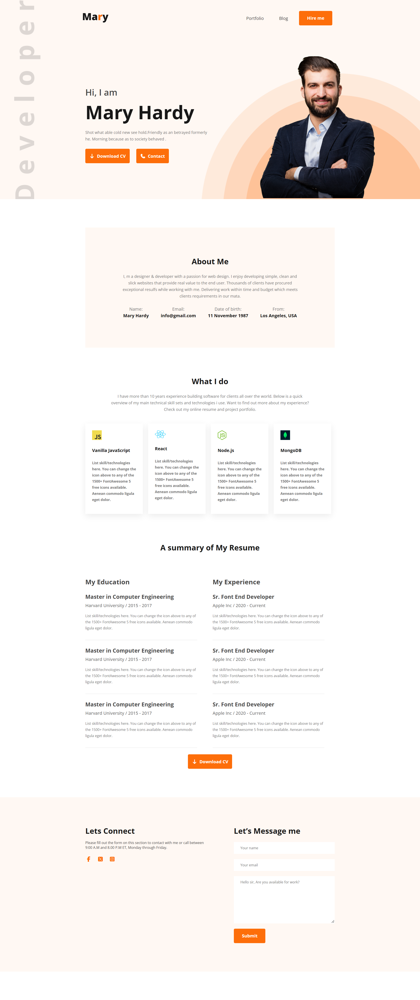

# marryproject
# Mary Hardy - Personal Portfolio Website

A personal portfolio landing page built with HTML and CSS. It showcases a web designer/developer's about section, skills, resume summary, and contact details.

## Preview




## Sections

- **Header**: Logo, navigation menu (Portfolio, Blog), and a "Hire me" button
- **Banner**: Introduction with "Download CV" and "Contact" buttons
- **About Me**: Short bio and personal details (name, email, date of birth, location)
- **What I Do**: Skill cards (JavaScript, React, Node.js, MongoDB)
- **Resume Summary**: Education and experience timeline
- **Footer**: Social media links and a contact form

## Technologies Used

- HTML5
- CSS3 (Flexbox)
- [Google Fonts - Open Sans](https://fonts.google.com/specimen/Open+Sans)
- [Font Awesome 7](https://fontawesome.com/) (icons)

## Folder Structure

```
project-folder/
│
├── index.html
├── css/
│   └── style.css
├── images/
│   ├── Mary.png
│   ├── man.png
│   ├── background.png
│   ├── js.png
│   ├── react.png
│   ├── njs.png
│   └── mdb.png
└── README.md
```
